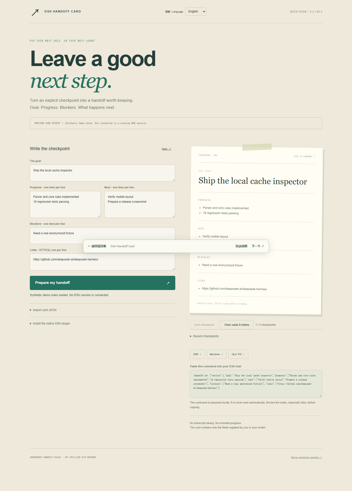
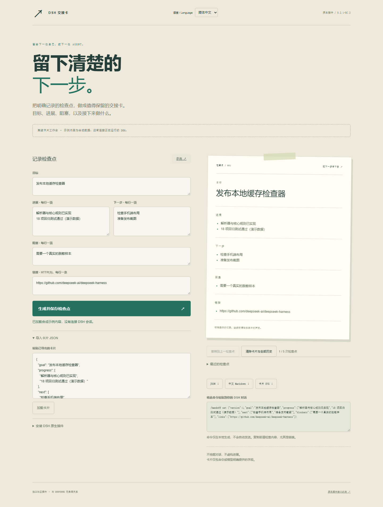

# DSH Handoff Card
**给下一位自己或 Agent，留张接得住的交接卡。** DSH 原生命令与模型工具，专门记录明确提供的阶段检查点。

[English](README.md) · MIT · Node.js 22+ · 插件零运行依赖



## 一分钟试玩
安装 Git 和 Node.js 22+ 后，运行：

```sh
git clone https://github.com/Euphoria2586/dsh-handoff-card.git
cd dsh-handoff-card
node cli.mjs serve
```

打开 <http://127.0.0.1:4188> 就能试玩。不用 Git 也可以点 **Code → Download ZIP**，解压后在目录里运行 `node cli.mjs serve`。试玩不需要账号、API Key 或安装依赖。先试试手感，想接入自己的 DSH 时再按下方步骤安装。

## 安装
在项目目录运行，目标宿主版本 **@deepseek-ai/dsh 0.2.1-rc.2**：
```sh
node setup.mjs --write ./cordis.yml
npx @deepseek-ai/dsh@0.2.1-rc.2 web --patch ./cordis.yml --no-open
```
DSH 需单独安装或通过 npx 获取。setup 生成包含当前插件绝对路径的 Cordis insert patch，不覆盖已有文件；不带参数仅打印 YAML。移动项目后请重新生成。

## 两种原生入口
```text
/handoff set {"goal":"完成解析器","progress":["核心已实现"],"next":["跑回归测试"],"blockers":[],"links":[]}
/handoff show
/handoff json
/handoff clear
```
同时注册模型工具 `handoff_update`：接收相同的五个字段，更新当前 session 检查点并返回简短确认。输入为 raw JSON Schema，由 engine 再做边界校验；输出遵循 DSH 的 canonical string + output.render 契约。命令与工具均通过 Session 对象隔离，支持取消检查。

## 卡片格式
goal 必填，非空且最多 300 字符。progress、next、blockers、links 均为可选字符串数组，最多 12 项，每项最多 500 字符。未知字段拒绝，规范化导出附带 version:1。链接仅允许不含用户名密码的 HTTP(S) URL。JSON 文本导入最多 128 KiB，拒绝控制字符。

卡片内容来自用户或模型的明确输入，不自动总结对话，不检查文件，也不保证进展声明正确。set 完整替换卡片，校验失败保留此前检查点。

## 状态与隐私
卡片仅存活在当前插件的 session 内存中，重启或热重载会丢失，请提前用 show / json 导出。插件不自动写磁盘或恢复历史。

`recordInput:false` 防止原始命令参数在 command/run 重复记录，**但 DSH 自身可能保存展示出来的命令结果、模型工具参数和结果**。不要放密钥。clear 仅清空插件内存，不删除先前宿主日志。

## 离线演示
```sh
node cli.mjs serve
# 打开 http://127.0.0.1:4188
node cli.mjs inspect examples/card.json --format md
node --test
```
网页明确标注合成示例，不连接运行中的 DSH。编辑卡片后可导出 JSON、Markdown、SVG，或得到可复制的 /handoff set 命令；不会自动发送。

## 已验证的接口
依据官方 [固定提交 687f282](https://github.com/deepseek-ai/deepseek-harness/blob/687f282e8625c6b8d11ff58211a90524be2e4317/docs/cookbook/extension-cookbook.md)、[命令 API](https://github.com/deepseek-ai/deepseek-harness/blob/687f282e8625c6b8d11ff58211a90524be2e4317/packages/interaction/commands/src/index.ts)、[工具约定](https://github.com/deepseek-ai/deepseek-harness/blob/687f282e8625c6b8d11ff58211a90524be2e4317/docs/cookbook/adding-a-tool.md)、[tools runtime](https://github.com/deepseek-ai/deepseek-harness/blob/687f282e8625c6b8d11ff58211a90524be2e4317/packages/core/tools/src/index.ts) 核实（2026-10-22）。

批次集成检查在真实 Cordis 4.0.5 + commands/tools 0.2.1-rc.2 中验证了插件加载、命令分发、工具执行与校验、session 隔离及卸载；不宣称完整的真实模型全链路运行。独立测试覆盖格式边界、取消、状态隔离、输出转义与回环服务器安全。RC 接口可能变化，请固定宿主版本。

欢迎贡献明确的导出格式与易用性改进，不要自动挖掘私人历史或虚构进度。宣传稿见 [LAUNCH.md](LAUNCH.md)。独立社区项目，与 DeepSeek 无隶属关系。

## 最近检查点与撤销
原生插件按 Session 隔离，**最多保留 5 次检查点（包含当前版本）**。人工 set 与模型工具 handoff_update 共享同一撤销历史；连续相同内容不会占用新名额。无效或已取消的更新不会改动历史。
```text
/handoff history
/handoff undo
/handoff show zh
/handoff history zh
/handoff undo zh
/handoff clear zh
```
history 列出版本序号和目标。undo 丢弃最新版本并恢复前一版，不支持重做，最后一版不能再撤销；后续保存继续使用新的序号。clear 清除当前卡片与**全部撤销历史**。所有版本仅在内存中，不写磁盘；宿主已产生的命令或工具日志不受影响。

离线网页提供同样的本地历史、撤销和清除按钮。生成检查点才会保存，单纯编辑字段不会保存；撤销会丢弃未保存的编辑。加载示例或导入有效 JSON 也会加入历史。关闭标签页后历史丢失，请提前导出。

## 中文支持
右上角支持中英切换，或通过 `?lang=zh` / `?lang=en` 初始化；没有有效参数时仍默认英文。切换保留输入、历史、预览和禁止导出的错误状态，不会自动翻译你填写的内容。切换中文后点击示例，可加载中文合成数据。

原生命令可追加 zh 获取中文展示；网页 Markdown / SVG 随当前界面语言导出，JSON 字段保持兼容。

可选浏览器检查：单独提供 Playwright（或 `PLAYWRIGHT_MODULE_PATH`），运行 `node scripts/browser-smoke.mjs`，可设 `PLAYWRIGHT_CHANNEL=msedge`。覆盖 URL 初始化、未保存输入下切换语言、5次历史上限、撤销、清除、无效输入、中文导出和手机布局。



